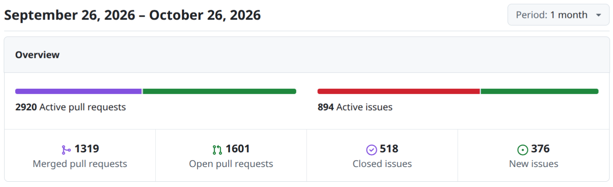
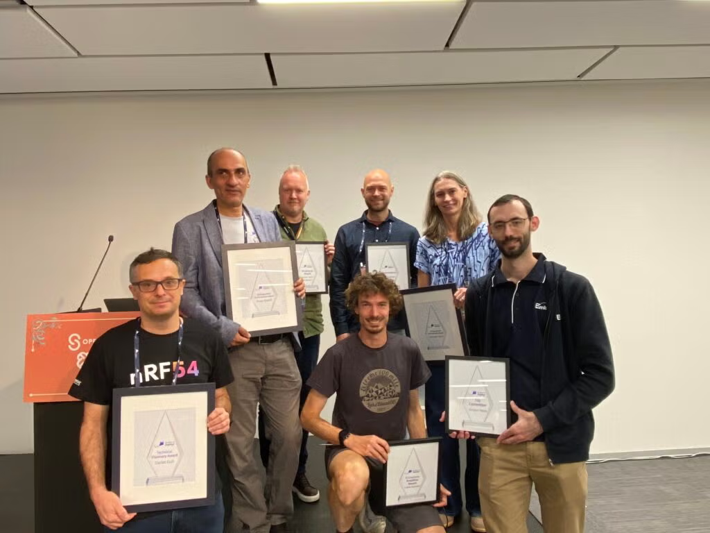
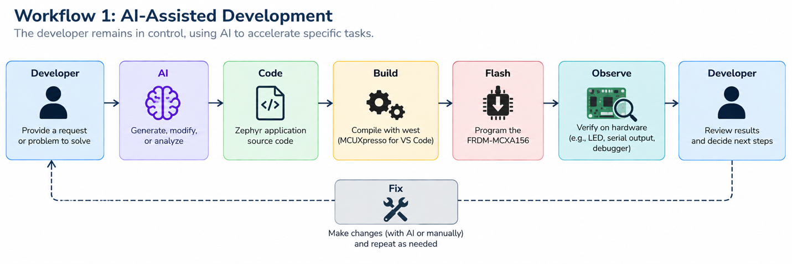
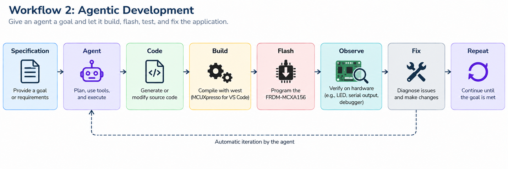
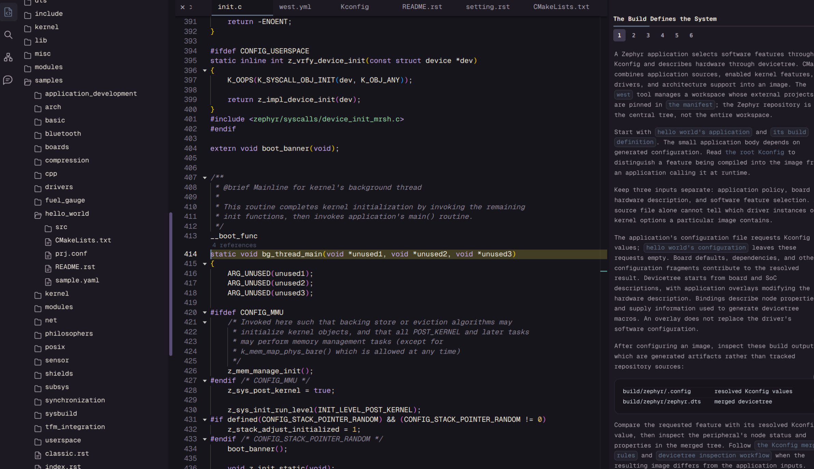
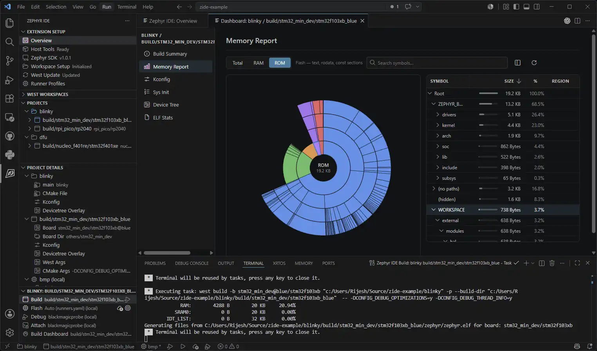

# Zephyr 爱好者月刊（第 22 期 202610）

这里记录 Zephyr 最新的消息和值得分享的内容，每月最后一周发布。

本杂志开源（GitHub：[lgl88911/Zephyr_Fans_Monthly](https://github.com/lgl88911/Zephyr_Fans_Monthly)），欢迎提交 issue、投稿或推荐 Zephyr 相关内容。

## 项目数据




不包括合并，391 位作者向主分支推送了 2172 次提交，向所有分支推送了 2689 次提交。
在主分支上，共有 4190 个文件发生了变化，新增了 135197 行，删除了 24575 行。


近期动向
- [新增 Applet（小程序）子系统](https://github.com/zephyrproject-rtos/zephyr/pull/116666)
- [新增继电器设备驱动类](https://github.com/zephyrproject-rtos/zephyr/issues/119021)
- [将内核栈和堆放入 devicetree 描述的内存区域](https://github.com/zephyrproject-rtos/zephyr/pull/119188)
- [新增 KNX 协议支持](https://github.com/zephyrproject-rtos/zephyr/pull/119619)
- [RFC：增加 UWB 子系统支持](https://github.com/zephyrproject-rtos/zephyr/issues/112480)
- [Twister 新增 hw-test snippet](https://github.com/zephyrproject-rtos/zephyr/pull/118493)
- [新增性能事件（Performance Event）子系统](https://github.com/zephyrproject-rtos/zephyr/issues/119608)
- [RFC：增加控制远程核的 AMP API](https://github.com/zephyrproject-rtos/zephyr/issues/114707)
- [RFC：增加 OpenAMP 从端 remoteproc 驱动](https://github.com/zephyrproject-rtos/zephyr/pull/105778)
- [支持 SoC 内部音频编解码器](https://github.com/zephyrproject-rtos/zephyr/issues/120240)
- [内核进程支持与 Applet 子系统](https://github.com/zephyrproject-rtos/zephyr/issues/114724)
- [RFC：将 posix-next 移交 Zephyr 项目托管](https://github.com/zephyrproject-rtos/zephyr/issues/121479)
- [统一时钟控制 API 用法](https://github.com/zephyrproject-rtos/zephyr/pull/118560)
- [文档新增 HAL 模块编写指南](https://github.com/zephyrproject-rtos/zephyr/pull/121359)

## 新闻与活动

1、[Zephyr 项目公布 2026 十周年社区奖获奖名单](https://www.zephyrproject.org/celebrating-the-people-behind-zephyr-the-2026-10th-anniversary-community-award-winners/)

Zephyr 项目在十周年之际设立社区奖项，六大奖项覆盖代码提交、文档、架构决策、生态推广与社区运营。杰出成就奖破例授予三人，表彰对项目产生持续性、决定性影响的贡献者。



| 奖项 | 获奖者 | 所属机构 | 核心贡献 |
| --- | --- | --- | --- |
| 杰出成就奖 | Anas Nashif | Intel | 项目创始人之一，从 Day 1 领导项目十年；主分支提交量第一（2016 年至今超 2500 次）；文档贡献最大，维护 Sphinx/Doxygen 工具链 |
| 杰出成就奖 | Maureen Helm | Analog Devices（原 NXP） | 在 NXP 建立 vendor-HAL 模型，使 Zephyr 得以跨 SoC 家族扩展；Arm 架构与传感器维护者，前 TSC 主席 |
| 杰出成就奖 | David Leach | 原 NXP | 早期定义性领导者，TSC 与治理委员会成员；倡导开放、协作、厂商中立的生态，导师角色突出 |
| 技术远见奖（TSC 荣誉） | Carles Cufí | Nordic Semiconductor | 架构工作组主席，主导增长与可持续性的关键架构讨论，跨组织建立共识 |
| 顶级提交者 | Jordan Yates | Embeint | 6 年持续贡献，自 2020 年超 500 个 PR 合并、累计超 1000 次提交；覆盖电源管理、无线、传感器、LTE 调制解调器与 Kconfig/Twister 工具链 |
| 勤恳工作者奖 | Henrik Brix Andersen | Vestas | CAN 子系统维护者、TSC 当选成员；Issue 分类、贡献者指导与 Discord 答疑，维持社区高效友好的协作氛围 |
| 文档贡献者 | Emil Gydesen | Antero ApS | 2018 年起主导 LE Audio，实现并重构 20~30 项蓝牙规范的配置文件与服务，累计代码超 13 万行，每项均配齐实现、文档、示例与测试 |
| 生态放大器奖 | Fabio Baltieri | Google | 几乎参与所有工作组，与 Benjamin Cabé 联合主持 Zephyr Podcast；推动 PR Dashboard 等贡献者体验改进 |


2、[英飞凌与德州仪器同步升级为 Zephyr 白金会员](https://www.zephyrproject.org/zephyr-project-expands-semiconductor-industry-support-as-infineon-technologies-and-texas-instruments-upgrade-to-platinum-membership/)

两家半导体巨头于 2026 年 10 月同步升级为白金会员。

| 公司 | 贡献历史 | 升级后的重点方向 |
| --- | --- | --- |
| TI（德州仪器） | 自 2016 年项目创立起即参与，提供软件与板级支持，将 Zephyr 集成进其嵌入式产品组合 | 持续投资开源软件与开发者社区，降低从概念到商业产品的门槛 |
| Infineon（英飞凌） | 活跃贡献者，在多个嵌入式平台支持 Zephyr | 扩大 MCU、汽车 MCU、连接产品组合的软件复用与可移植性；提升开发者体验、安全性与硬件支持广度 |


3、[Synaptics 与 Google 联合发布 Astra SR200 系列 xMCU，原生采用 Zephyr RTOS](https://www.synaptics.com/company/news/synaptics-astra-sr200-series-multimodal-edge-ai-processors)

Synaptics 于 2026 年 10 月 20 日发布 Astra SR200 系列，首创「xMCU」（扩展微控制器）品类，将应用处理器级别的多模态 AI 能力引入超低功耗 MCU 领域。

| 维度 | 内容 |
| --- | --- |
| 产品型号 | SR210 / SR230 / SR250，引脚兼容，200~400 GOPS 三档算力 |
| 计算架构 | Google Coral NPU + Arm Cortex-M85/M52 异构核心，分层电源域 |
| 存储 | 可扩展至数百 MB 的高带宽定制 DRAM，消除外部 DRAM 依赖 |
| 软件栈 | Zephyr RTOS + 开源 Torq NPU 编译器（基于 MLIR/IREE），支持行业标准 AI 框架 |
| 安全与连接 | PSA Level 3 / CC EAL4+ 认证，TSN、CAN-FD 等工业连接 |
| 目标场景 | AI 可穿戴、智能安防、工业视觉、语音系统、Physical AI / 机器人 |

边缘 AI 的下一波浪潮是「理解环境并本地行动」的设备，xMCU 通过异构 AI 原生架构、分层内存设计与工业级连接，在无需 Linux 和外部 DRAM 的情况下实现这一目标，突破传统 MCU 的能力边界。选择 Zephyr 配合开源编译器，显示出其对开源、标准化路径的承诺，与 Google Coral 的开放理念形成呼应。

## 文摘与观点

1、[从 AI 辅助到代理式 Zephyr 开发：构建、烧录、修复的自主闭环](https://www.beningo.com/agentic-zephyr-development-build-flash-fix/)

这篇文章系统阐述了如何将 AI 嵌入 Zephyr 开发流程，从「AI 辅助」演进至「代理式」（Agentic）模式。这是首次在网络上看到有人将 AI 流程化、规范化地用在 Zephyr 开发上，其 AI 开发经验值得在不同嵌入式开发领域借鉴。作者 Jacob Beningo 以 NXP FRDM-MCXA156 为硬件平台，提出由 Skills、Agents、RAG、MCP 四层构成的 AI 开发栈：Skills 规范 Zephyr 特定任务（devicetree 配置、Kconfig 调优、构建诊断），Agent 基于 LLM 执行规划，RAG 以硬件文档作为 grounding 以避免幻觉，MCP 则赋予 Agent 操作真实工具链的「手」——调用 `west` 构建、烧录目标板、通过串口 MCP 服务器读取运行输出。

文章对比两种工作流：
- AI 辅助模式中，开发者掌控 build-flash-observe 循环，AI 仅加速单点任务
- Agentic 模式则让 AI 自主迭代闭环，以硬件反馈为决策依据





实战中 Agent 不仅能定位软件时序缺陷（HDC3021 驱动未等待转换完成），还能识别物理层错误（Click 板反插），最终生成 root cause 分析文档，完成知识积累。Agentic 开发并非要取代工程师，而是将验证循环的过程自动化；AI 的价值在于把每次故障的经验转化为可复用的 Skills 与预防规则。作者建议从「一个 Skill、一个工具、一个闭环小应用」渐进起步。

2、[从三种架构到真正的跨架构 RTOS：Zephyr 的可移植性演进与平台战略](https://planux.com/blog/architecture-evolution/)

Zephyr 最初仅支持 Arm、x86 和 ARC 三种架构，Zephyr 创始团队决策将架构独立性内建于内核核心，为其奠定了可扩展的基础。Zephyr 发展至今已支持十余种架构，涵盖 MCU、应用处理器、DSP、模拟器，并正向 TriCore（汽车安全）和 Hexagon（DSP 异构计算）扩展。

作者 Anas Nashif 的观点：多架构支持的本质不是 `arch/` 目录下的条目数量，而是使固件团队能够跨异构硬件环境构建可复用软件。在现代系统中，单产品常集成 MCU、DSP、安全岛等多种核心，Zephyr 通过清晰的架构抽象层将特定细节隔离于接口之后，使公共内核服务、驱动框架、测试基础设施、CI 模型得以跨架构复用，避免重复实现与生态碎片化。

Zephyr SDK 则提供统一工具链，将理论上的架构支持转化为实际开发体验。Zephyr 的演进体现了一种平台战略：赋予开发者选择最优硬件的自由，同时免除重复构建固件平台的负担。

3、[MCU 大厂接连出手，这个开源 RTOS 会一统天下吗](https://www.eet-china.com/mp/a529448.html)

该文章梳理了 2024-2025 年 MCU 行业围绕 Zephyr 的生态重构浪潮。TI、英飞凌、瑞萨三大巨头同期升级白金会员，ST、兆易创新等持续跟进，标志着半导体厂商从「各自封闭 SDK」转向「开源中立平台」的战略转向。

Zephyr 的价值在于：以 Linux 基金会托管的治理架构，提供跨 MCU/MPU/无线 SoC 的统一开发流，原生集成安全启动、OTA、网络协议栈等现代嵌入式必需能力，能直接应对欧盟 CRA 法规与长周期维护需求。英飞凌将 AURIX 汽车 MCU 纳入支持，更打破了其仅适用于 IoT 的边界。

Zephyr 并非 FreeRTOS 的简单替代：设备树 + Kconfig + west 工具链对传统 MCU 工程师形成显著学习门槛，资源占用与维护复杂度也倍受质疑；国内 FreeRTOS 与 RT-Thread 存量巨大，Zephyr 的跨平台移植优势在芯片不频繁更换的场景中价值有限。文章最后的判断是：Zephyr 正成为复杂嵌入式系统的「默认选项」，但碎片化生态将长期共存。

4、[Zephyr 嵌入式 RTOS 选型指南：从裸机到 Linux 之间的技术决策框架](https://invisto.be/en/insights/when-to-choose-zephyr-for-an-embedded-product)

技术选型应基于产品本质特征（时序、连接性、功耗、安全、硬件变体复杂度、生命周期），而非追逐框架流行度。

Zephyr 的定位介于裸机与嵌入式 Linux 之间，其价值体现在「复杂性交汇点」——当多任务并发、网络协议栈（BLE/Wi-Fi/蜂窝）、硬件可移植性、安全启动与固件更新、低功耗协调等需求同时出现时，Zephyr 作为集成平台能显著节省集成工作量。其 devicetree/Kconfig 机制实现硬件描述与软件配置的解耦，对产品族管理尤为关键。安全方面，Zephyr 提供 MCUboot 集成能力，但安全是架构设计的结果，需全生命周期管理 SBOM 与 CVE。

但作者反对 RTOS 滥用：
- 简单确定性状态机（如电源控制器）应坚持裸机，保证代码透明与直接可控
- FreeRTOS 在紧凑场景仍有优势
- 嵌入式 Linux 则统治复杂 HMI 与应用处理器场景
- 工业系统常采用「Linux + Zephyr MCU」混合架构

5、[嵌入式系统五大趋势：AI 应用浅层化、Zephyr 崛起、物理 AI 挑战与 Rust 渗透](https://www.designnews.com/embedded-systems/five-embedded-systems-trends-engineers-must-watch-ai-zephyr-rust-and-physical-robotics)

本文基于 Embedded World North America 2026 提出五大趋势：
| 趋势 | 要点 |
| --- | --- |
| AI 用得广但不够深 | 几乎所有工程师都在用 AI，但仅约 2% 掌握智能体、RAG、MCP 等非基础提示词的技能，多数仍是一次性对话式试验 |
| Zephyr 将主导通用嵌入式 RTOS | 竞争对象是 FreeRTOS/ThreadX 而非 VxWorks；核心竞争力是生态（统一硬件抽象、驱动、配置、构建、测试框架）而非内核 |
| 物理 AI 成为新前沿 | 核心矛盾是 AI 模型的非确定性 vs 实时控制的确定性时序，安全机制必须独立于 AI 决策而正确运行 |
| Rust 进入务实采用阶段 | 混合架构：C/C++ 维护存量，Rust 开发新子系统；Rust 不自动消除缺陷，仍须理解并发、资源与时序 |
| 技术进步速度超越团队跟进能力 | 解法是「有意识的现代化」：识别瓶颈 → 问题驱动选型 → 实验验证 → 迭代扩展 |

其中最具说服力的案例来自 Microchip 的演示：基于 Zephyr + AI 的产品平台将衍生产品开发周期从原型到首款约 2 个月，压缩至第二款 2 周、第三款 2 天、第四款 2 小时。但作者同时提醒，2 小时生成产品不等于 2 小时完成工程验证。

6、招聘信息

https://careers.nordicsemi.com/jobs/8591046-senior-embedded-software-engineer-bluetooth-le-audio

Nordic Semiconductor 招聘高级嵌入式软件工程师（蓝牙 LE Audio），明确要求具备与大型开源项目协作的经验，日常工作直接基于 Zephyr RTOS 与 nRF Connect SDK，并需持续向 Zephyr 主仓库上游贡献 LE Audio 配置文件与服务。

https://careers.amd.com/careers-home/jobs/92870?lang=en-us

AMD 在印度海得拉巴招聘高级嵌入式软件工程师，要求能在 Linux kernel、Zephyr 及 Baremetal 三种环境下开发外设驱动（SPI、I3C、USB、Ethernet），10 年以上经验并具备硬件 bring-up 实战能力。Zephyr 在此不是边缘补充方案，而是与 Linux 并列的三大目标环境之一，契合 AMD 日益扩展的 Arm/RISC-V 嵌入式与边缘计算产品线。

## 技术与工具

1、[Antmicro 推出开源 STM32H7 HDMI 开发板：专为 Zephyr 图形渲染优化](https://www.zephyrproject.org/open-hardware-stm32h7-hdmi-board-optimized-for-rendering-graphics-on-zephyr-rtos-devices/)

Antmicro 为 Zephyr 生态量身打造的开源硬件平台 STM32H7 HDMI Board。该平台以 STM32H747XIH6 双核 MCU 为核心，集成 DSI/HDMI 视频输出、音频编解码、以太网（PoE）、双路 CAN、USB 2.0，并配备可扩展至 512 MB 的 SDRAM 与 4 GB eMMC，为需要现代 GUI 的嵌入式设备提供原型基础。

通过开源硬件与 Zephyr 软件栈的深度融合，可降低 HVAC 面板、售货机、门禁终端等智能设备的开发门槛。Antmicro 不仅提供硬件，还构建了完整工具链——grvl 轻量级 GUI 库实现美观界面渲染，RDFM 框架支持远程 OTA，Renode 仿真加速软硬件协同，其 USB HID Boot 功能已直接 upstream 至 Zephyr 主线。

2、[ExecuTorch 正式成为 Zephyr 官方模块](https://www.zephyrproject.org/executorch-integrated-with-zephyr-rtos/)

ExecuTorch 作为官方 Zephyr 外部模块完成技术集成，标志着 Zephyr 生态已原生支持 PyTorch 边缘 AI 部署，开发者可通过标准 west 工作流将深度学习模型嵌入资源受限设备。文章以 Zephyr 4.4.0 为基础，演示了从模块配置（`west.yml`）、Kconfig 启用到 `west build` 的完整开发体验，并在 Alif Ensemble E8 上游板级目标上完成验证。

3、[从 PyTorch 到实机边缘 AI：Renesas RA8P1 上的 ExecuTorch + Ethos-U55 实践](https://developer.arm.com/community/arm-community-blogs/b/embedded-and-microcontrollers-blog/posts/from-pytorch-to-live-edge-ai-executorch-and-zephyr-on-renesas-ra8p1-with-arm-ethos-u55)

Arm 与 Renesas 合作实现了 PyTorch 模型到实时嵌入式 AI 应用的完整开源部署，通过 Zephyr、ExecuTorch 与 Arm Ethos-U55 NPU 的协同，消除传统 MCU 模型部署中的框架转换与平台集成壁垒。

4、[在 Zephyr 上直接运行 NanoMQ MQTT 代理](https://www.emqx.com/en/blog/nanomq-on-zephyr-rtos)

本文论证在 Zephyr 上运行 NanoMQ MQTT 代理的可行性，打破「Zephyr 仅作 MQTT 客户端」的常规架构。通过消除 Linux 网关中间层，MCU 可直接聚合 Modbus、串口等异构协议，并在网络中断时本地缓冲数据，降低边缘场景的功耗与维护成本。

技术实现上，文章详述了 Zephyr 四大关键特性（Kconfig 可配置性、devicetree 硬件抽象、内置 BSD 兼容网络栈、POSIX API 子集）如何支撑移植，并重点记录了两个框架级陷阱：`shared_multi_heap` 的非线程安全性导致 PSRAM 堆损坏，以及 `net_mgmt` 回调掩码采用完整层码匹配而非位运算的隐蔽行为。平台适配层 22 个文件完整映射了 POSIX 到 Zephyr 的接口转换，其中 `readv/writev` 模拟、管道缺失处理、原子操作回退等细节具有通用的参考价值。

文章提供 ESP32-S3 硬件与 qemu_x86 模拟两套 Demo。当前实现适用于受控网络内的小规模边缘聚合，但 TLS、MQTT 认证、持久化等能力尚待完善，采用该方案的设备不应暴露于公网。

5、[JBLopen TSFS 事务安全文件系统正式支持 Zephyr](https://www.jblopen.com/tsfs-zephyr/)

TSFS 深度集成 Zephyr 的 VFS、构建系统与驱动接口，为嵌入式开发者提供兼具高可靠性、高性能与低资源占用的企业级文件系统选择。

TSFS 作为外部模块通过 `EXTRA_ZEPHYR_MODULES` 集成，配置纳入 Kconfig；实现对 Zephyr VFS 的完整支持——开发者可用标准 `fs_register()` 与 `fs_mount()` API 挂载 TSFS，并可通过数值偏移配置获取扩展错误码（如 `FS_TSFS_ERROR_CORRUPT`）。

存储层面，TSFS 复用 Zephyr 现有的 flash/disk 驱动，支持 NOR、SD/eMMC 及串行/并行 NAND。文章提供了从 CMake 配置、实例初始化、介质创建、格式化到 VFS 挂载的完整代码示例，并包含集成测试验证步骤，让 Zephyr 用户能在不牺牲原生 API 灵活性的前提下获得事务安全、跨文件原子操作、磨损均衡等特性，特别适用于固件升级等高可靠性场景。

6、[基于 Bao Hypervisor 在单平台上运行双 Zephyr 实例](https://medium.com/the-cit-ece-frontier/can-two-zephyr-rtos-instances-run-on-one-embedded-platform-288b2cba4c0c)

本文阐述了在单一嵌入式平台上通过 Bao Hypervisor 运行双 Zephyr 实例的虚拟化方案。文章指出，嵌入式虚拟化的本质并非简单堆砌软件，而是通过静态分区实现独立软件环境对共享硬件的受控、隔离使用。

| 层级 | 组件 | 功能定位 |
| --- | --- | --- |
| 虚拟化层 | Bao Hypervisor | 提供静态分区与隔离机制 |
| 客户机 1 | Zephyr RTOS — Guest 1 | 独立 RTOS 执行环境 |
| 客户机 2 | Zephyr RTOS — Guest 2 | 独立 RTOS 执行环境 |
| 硬件层 | 嵌入式处理器、内存、外设 | 物理资源池 |

Bao 的静态分区将 CPU、内存区域、外设访问按配置固定分配给各客户机，建立明确边界，避免非预期干扰。

启动流程为：硬件初始化为虚拟化就绪 → Bao 启动建立分区 → 资源指派 → 两个 Zephyr 客户机分别引导 → 各自应用独立运行，验证隔离性与并发性。

作者指出，Zephyr 的轻量性与可配置性使其成为理想的虚拟化客户机，而 Bao 的静态分区恰好满足工业与汽车场景对隔离确定性的要求；但实时行为受硬件、配置与负载共同影响，生产部署或安全认证前仍需实验验证。

7、[Percepio Detect 2026.1 新增 Zephyr RTOS 支持](https://www.newelectronics.co.uk/content/news/percepio-adds-zephyr-rtos-support-to-detect-20261-observability-platform)

Percepio 发布 Detect 2026.1 可观测性平台，新增对 Zephyr 的支持，发布时点恰逢 Zephyr 十周年，也是其作为社区银牌成员的技术回馈。

区别于传统持续 trace 流，平台仅在检测到异常时自动捕获紧凑诊断快照（含执行跟踪与可选核心转储），开发者可通过 Tracealyzer 深入分析根因；针对 Cortex-M 设备还支持 API 主动触发快照，实现非致命错误的预警式捕获。文中案例显示，某固件经数周 CI 测试未现故障，启用 Detect 后却暴露后台通信任务的间歇性时序隐患，避免了潜在看门狗复位风险。

8、[esp-sdr-zephyr：把 ESP32 的 Wi-Fi 射频变成通用 SDR](https://github.com/cyber-murmel/esp-sdr-zephyr)

最近有一个比较火的项目 ESP-SDR，它将 ESP32 系列芯片的 Wi-Fi 射频重新用于通用 SDR 的 I/Q 采样与信号处理。原项目基于 ESP-IDF 开发，而这个项目是基于 Zephyr 开发的 esp-sdr，严格遵循 Zephyr 工程规范：采用 `west` 管理依赖，以 `module.yml` 声明模块身份，通过 `sysbuild` 实现多镜像系统构建。

该项目对 Zephyr 技术的使用体现在三个层面：
- 内核层利用 ESP32-S3 的 SMP 双核支持实时信号处理
- 驱动层实现 USB CDC-NCM、软件 IEEE 802.15.4 PHY 及动态 llext 应用加载
- 生态层完整接入 Twister 测试框架、Doxygen+Sphinx 文档体系与版本管理

项目还针对 ESP32-C5 的诊断总线与 DAC 引擎开发了 40~80 MS/s 的高速数据通路，并通过 `west blobs` 管理射频校准二进制文件。作为从 ESPARGOS 向 Zephyr 生态的移植扩展，该工作提供了捕获、流式传输、协议分析等十余种应用，展示了 Zephyr 在射频信号处理领域的工程可行性。

9、[GitShaman：面向 Zephyr 等大型代码树的语义化代码智能平台](https://gitshaman.com/zephyr-rtos/)

GitShaman 以「语义化代码智能」为核心理念，将大规模源代码树转化为可导航、可查询的结构化知识图谱。技术架构围绕三大支柱：基于 VS Code + LSP 的编辑体验、代码索引化搜索引擎，以及融合编译器与图上下文的语义增强层——明确支持人类开发者与 AI Agent 以「含义查询」替代「文本检索」。

平台精选覆盖操作系统内核、Android 发行版、编程语言实现及嵌入式实时系统四大领域，Zephyr 作为与 FreeRTOS 并列的现代物联网操作系统被收录，与 seL4、LK 共同构成嵌入式内核的认知谱系。

借助该工具可以更容易理解 Zephyr 代码库。



10、[IDE for Zephyr：VS Code 扩展的全流程自动化开发](https://docs.zephyrproject.org/latest/develop/tools/ide_for_zephyr_vscode_ext.html)

Mylonics 为 Zephyr 开发的 VS Code 扩展是首个 Zephyr 官方 IDE 插件。核心思路是通过深度集成 west、SDK、Twister、Cortex-Debug，实现从环境搭建到调试部署的全流程自动化与可视化。

该扩展针对 Zephyr 项目的特殊性设计了关键机制：自动解析 `runners.yaml` 的 `zephyr-ide-west` 调试器、基于 `.vscode/zephyr-ide.json` 的团队配置共享，以及四种灵活的工作区初始化模式；对 Zephyr SDK 多版本管理和按架构工具链选择的支持，则直击嵌入式工具链复杂性的痛点。Build Dashboard 的内存旭日图、Kconfig 交互编辑、Twister 测试面板，将 Kconfig/devicetree 这一 Zephyr 特有的配置体系以图形化方式呈现，显著降低了学习门槛。



## 课程与教程

1、[Zephyr 集成 Arm Ethos-U NPU 完整指南：从设备树配置到模型部署](https://arm-software.github.io/CMSIS-Ethos-U/main/zephyr/index.html)

本文阐述了在 Zephyr 中集成 Arm Ethos-U NPU 的完整流程，通过分层配置实现硬件加速推理的可靠部署。文章详细解析了四个必须协同一致的配置层：
- Vela 模型编译器负责生成针对特定 Ethos-U 架构的命令流；
- 设备树精确描述 NPU 的寄存器映射、中断及安全属性；
- Kconfig 启用 TFLM 与 Ethos-U 的软件集成；
- 板级支持包提供物理地址与中断等硬件细节。

文档覆盖了 Zephyr 特有的技术要素：`arm,ethos-u` 设备树绑定的完整属性规范、`west` 构建工作流，以及通过 CMSIS Solution 扩展在 VS Code 中构建 Zephyr 应用的现代开发范式。特别强调了 `fast-memory-region` 对 Ethos-U65/U85 Dedicated-SRAM 模式的关键作用，以及 `CONFIG_ETHOS_U` 与 Vela 编译模型的依赖关系。文末提供的 Corstone-300 FVP 示例与七项验证清单，为从仿真验证到硬件部署提供可操作路径。

2、[Qt Quick Ultralite 基于 Zephyr native_sim 的宿主机仿真开发指南](https://doc.qt.io/QtForMCUs/qtul-zephyr-native-sim.html)

本文档阐述了 Qt Quick Ultralite 2.12.3 在 Zephyr 4.4.0 的 `native_sim/native/64` 平台上的完整开发流程。通过 SDL2 中间层实现宿主机无硬件仿真，同时针对 `native_sim` 特有的进程退出机制设计线程安全的对象生命周期管理方案。

从 Zephyr 生态视角看，文档覆盖了设备树配置（`native_sim_native_64.overlay`）、Kconfig 集成机制、双堆内存架构（kernel heap 与 libc heap 分离），以及 `west` 构建工具链的深度整合。


## Zephyr 每月小知识

使用 Zephyr LLEXT 开发扩展时，如果想在**主应用之外独立编译扩展**（例如由不同团队、在不同机器上构建），可以借助 **Extension Development Kit（EDK）**。EDK 打包了主应用构建时所用的头文件与编译标志，让扩展开发者无需完整的 Zephyr 源码树也能正确编译扩展。

```bash
# 1. 构建主应用并生成 EDK
west build -b <board> -p=always <your_app>
west build -t llext-edk

# 2. 将 EDK 解压到任意目录
mkdir /tmp/edk
cp build/zephyr/llext-edk.tar.xz /tmp/edk
cd /tmp/edk
tar -xf llext-edk.tar.xz

# 3. 设置环境变量，指向 EDK 与 Zephyr SDK
export LLEXT_EDK_INSTALL_DIR=/tmp/edk/llext-edk
export ZEPHYR_SDK_INSTALL_DIR=</path/to/zephyr-sdk>

# 4. 在扩展目录中独立构建扩展（无需 west）
cmake -B build
make -C build
```

这样，扩展的编译与主应用完全解耦——只要拿到 EDK 压缩包，任何地方都可以用普通的 CMake/Make 构建扩展。

> **提示：** EDK 中的变量前缀（默认为 `LLEXT_EDK`）可通过 `CONFIG_LLEXT_EDK_NAME` 修改；若扩展只运行在用户态，可启用 `CONFIG_LLEXT_EDK_USERSPACE_ONLY` 以排除内核路由相关代码。
