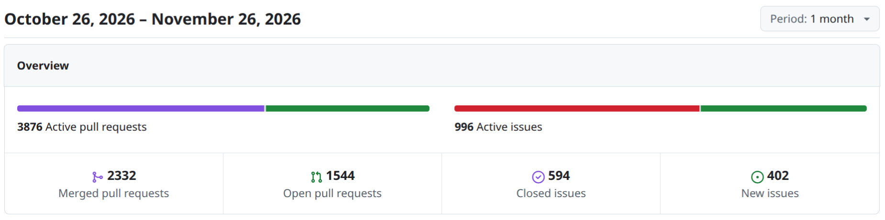
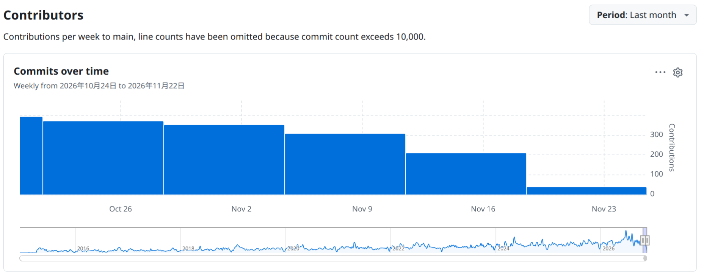

# Zephyr 爱好者月刊（第 23 期 202611）

这里记录 Zephyr 最新的消息和值得分享的内容，每月最后一周发布。

本杂志开源（GitHub：[lgl88911/Zephyr_Fans_Monthly](https://github.com/lgl88911/Zephyr_Fans_Monthly)），欢迎提交 issue、投稿或推荐 Zephyr 相关内容。

## 项目数据

不包括合并，620 位作者向主分支推送了 4806 次提交，向所有分支推送了 5726 次提交。
在主分支上，共有 14336 个文件发生了变化，新增了 606577 行，删除了 198805 行。

近期动向
- [新增 CR95HF RFID 驱动（SPI 支持）](https://github.com/zephyrproject-rtos/zephyr/pull/91254)
- [STM32 以太网新增 PHC 定时输出与 PPS 示例](https://github.com/zephyrproject-rtos/zephyr/pull/121471)
- [Renesas RH850 架构提案（一）](https://github.com/zephyrproject-rtos/zephyr/pull/124477)
- [Renesas RH850 架构提案（二）](https://github.com/zephyrproject-rtos/zephyr/pull/124774)
- [mcumgr UART 传输从 devicetree 实例化（破坏性 API 变更）](https://github.com/zephyrproject-rtos/zephyr/pull/121685)
- [Counter 与 PWM 新增批量捕获 API（提案一）](https://github.com/zephyrproject-rtos/zephyr/pull/122329)
- [Counter 与 PWM 新增批量捕获 API（提案二）](https://github.com/zephyrproject-rtos/zephyr/pull/112837)
- [新增 SFF-8472 可插拔模块支持（SFP/SFP+/SFP28）](https://github.com/zephyrproject-rtos/zephyr/pull/123842)
- [Memref：内存引用计数方案](https://github.com/zephyrproject-rtos/zephyr/pull/120964)
- [弃用 i2c_transfer_cb 及其辅助函数](https://github.com/zephyrproject-rtos/zephyr/pull/123276)
- [Zephyr 性能事件子系统](https://github.com/zephyrproject-rtos/zephyr/issues/119608)
- [offloader：新增通用卸载引擎与 PSA Crypto 卸载支持](https://github.com/zephyrproject-rtos/zephyr/pull/121721)
- [新增 HAL 模块开发指南](https://github.com/zephyrproject-rtos/zephyr/pull/121359)
- [新增 CODE_ASSUME() 与设备身份承诺](https://github.com/zephyrproject-rtos/zephyr/pull/122364)
- [新增 zerror 头文件](https://github.com/zephyrproject-rtos/zephyr/pull/111845)

## 新闻与活动

1、[Zephyr RTOS 4.5 发布](https://www.zephyrproject.org/zephyr-rtos-4-5-now-available-two-new-architectures-multimedia-pipelines-sboms-and-more/)

Zephyr 4.5 于 10 月 28 日发布，由 1200 余名贡献者共同完成。新增 Infineon TriCore 与 Qualcomm Hexagon 两种处理器架构；网络栈 TCP 吞吐最高提升 21%、UDP 提升 12%，并加入 QUIC / HTTP3、SSH 服务端与客户端、IPv4 NAT 与路由能力；引入 GStreamer 风格的实验性多媒体管线 mpipe、SPDX 3.0 SBOM，以及可让 AI Agent 读取板载传感器的 MCP 服务器。

更多信息可以参考 [Zephyr V4.5.0 发布](https://lgl88911.github.io/zephyr/zephyr-v4.5.0%E5%8F%91%E5%B8%83/)

2、[Zephyr 4.3.2 修复多个 CVE](https://github.com/zephyrproject-rtos/zephyr/releases/tag/v4.3.2)

4.3 分支的 bugfix 版本，修复多个 CVE，包括 POSIX `readdir()` 在目录名称超过 `NAME_MAX` 时的越界写（CVE-2026-6688）。仍停留在 4.3 分支的产品线应尽快评估升级。

3、[TI 将 Zephyr 引入全线嵌入式产品](https://www.open-electronics.org/ti-brings-zephyr-rtos-to-its-entire-embedded-range-mcus-mpus-and-wireless/)

TI 把 Zephyr RTOS 支持扩展至 MCU、MPU 与无线连接器件，提供统一的生产就绪开发平台，重点在于降低迁移成本并满足欧盟《网络弹性法案》（CRA）合规需求。

4、[Open Source Summit Japan 2026 上的 Zephyr 社区展台](https://www.zephyrproject.org/meet-the-zephyr-community-at-open-source-summit-japan-2026/)

社区将于 12 月 7—9 日在东京虎之门 hills forum 设 27 号展台，计划演示低功耗关键词识别、蓝牙信道测距、基于 Zephyr 的航天器计算机等内容。

5、[NXP 统一机器人平台加速物理 AI 部署](https://www.embedded.com/nxp-unified-robotics-platform-accelerates-physical-ai-deployments)

NXP 发布统一机器人平台，以神经轴架构整合感知、实时控制、AI 处理与通信；开源模块化 SDK 集成 PX4、Zephyr 与 ROS 2，配套四款无人机参考设计，宣称可把集成周期从数月缩短到数周。

6、[ABR 发布面向 Alif 处理器的语音 AI SDK](https://www.embedded.com/abr-launches-speech-ai-sdk-for-alif-processors)

Applied Brain Research 发布面向 Zephyr RTOS 的语音 AI SDK，支持 Alif Ensemble 上的流式语音识别与语音合成，全部本地运行。在 Ensemble E8 上首字延迟约 133 ms，识别引擎额外功耗约 15 mW。

7、[Zephyr 技术沙龙—— SOPIC & openKylin](https://mp.weixin.qq.com/s?__biz=Mzk1NzQ1NTI1NQ==&mid=2247486827&idx=1&sn=845c8c092b8e77b8611e26e3d4bdec40&chksm=c274630953c9f8e9d6e597fe7804deba16202d9c7af3d3967f38472e8ec83f2be8ebec937a35&mpshare=1&scene=1&srcid=1123KDT3R2Px8bMj3vm6gbFl&sharer_shareinfo=e20ca59e8f4efd2a6c3ba7f90ae22591&sharer_shareinfo_first=e20ca59e8f4efd2a6c3ba7f90ae22591&exportkey=n_ChQIAhIQccGW9D5RyO0gQvSb%2Bu5J4BKfAgIE97dBBAEAAAAAAHxFCeHhJscAAAAOpnltbLcz9gKNyK89dVj0x3PC3kzJGfdmSN5LZsU29KuY3PZE588JW4dlyRvhNLwWiZ0tPYCmaRsf2MIgH2kWfMe%2Bl%2B6AmyvsylBqLXkluV%2FuGfI2xcP%2BKKVj2J6XWaLededu7WF4alFAdL5uzQ7VZWbhFwbCdHl6xKhS8w2bZdDILuHvHvWYJe0utRcT%2FX6Vt0lhEUJXfEY1uWyPvTfeMGcVnr9%2F9gWKFePQIUODzt%2BSr%2BfRHC0zmaQi2a7%2FLNc2DPo5Al0ncQSjMmkXIuCXmNADEdAGEqDHhfe0E9ee4oRAFdNGXx3GHyWY0YO%2BW5j0SXRD2fp%2FXZHKb%2BOtvSaV%2FVLDZ2BT03r7&acctmode=0&pass_ticket=AVam%2FKRccZaTfdE2HIXsqOLccVtm3vNE%2BjewMcM3DkEBBNLXQPpsJP%2FzEVh62jaFBNgvwCcdfaozFJ%2BjcfI6gQ%3D%3D&wx_header=0&poc_token=HK1BCGujTuQ8Zsc9MbtXhLT7WTvX-dqzPKzddAb8)

由上海开放处理器产业创新中心与 openKylin社区联合主办，上海市经济和信息化委员会指导 ，面向国内开发者、用户与产业伙伴，搭建技术交流与协同对接平台。活动将围绕 Zephyr 生态演进、RISC-V 支持、国内社区共建、产业落地实践等方向开展分享与开放研讨，凝聚本土开发者力量，促进技术互通、资源协同，持续推动 Zephyr 生态在国内嵌入式产业的深耕与普及

## 文摘与观点

1、[Zephyr 4.5：MCU 上的 MCP 服务器、QUIC 与 FIDO2](https://byteiota.com/?p=27379)

文章认为 4.5 与以往“只加板卡和驱动”的版本不同，核心看点是内置 MCP 服务器让 AI 编码 Agent 直接读取物理传感器、闭合固件调试回路；文章同时解读 QUIC / HTTP3、SSH、FIDO2 over BLE、两种新架构与 178 块新板的意义。

2、[开源 Zephyr 为何适合安全边缘 AI 部署](https://prpl.works/why-the-open-source-zephyr-rtos-is-dominating-secure-edge-ai-deployments-in-2026)

文章论证 Zephyr 以极小内存占用（可低至 32 KB RAM）结合签名启动、硬件密钥存储、MCUboot 安全 OTA、TPM / TEE 支持，成为安全边缘 AI 的候选平台，并给出从选型、west 配置、安全模块到 AI 运行时与 OTA 的实践框架。

3、[设备厂商应关注的 2027 年五个嵌入式趋势](https://wizzdev.com/blog/embedded-systems-trends-2027)

从 Agentic 工作流与 AI 技能复用角度切入，分析 Zephyr 领先的原因：Linux 基金会中立的供应商治理、8 KB Flash / 5 KB RAM 起、1000+ 板卡、五年 LTS，以及欧盟 CRA 的时间点（2026 年 9 月 11 日报告义务、2027 年 12 月 11 日全面适用）。

4、[为什么大家开始使用 Zephyr 操作系统？](https://boardor.com/blog/why-is-everyone-starting-to-use-the-zephyr-operating-system)

从技术角度分析 Zephyr 在资源受限设备中份额上升的原因：Apache 2.0 许可、跨架构支持（x86 / ARM / RISC-V）、800+ 开发板、14000+ GitHub Stars，以及在内存管理、功耗管理、启动效率与调度算法上的优化设计。

5、[2026 年 IoT 操作系统横评中的 Zephyr 与 CRA](https://plugroute.com/best-iot-operating-systems)

横向评估指出 Zephyr 与 Ubuntu Core 是 CRA 合规对齐度最高的两个平台；解释 MCUboot 安全启动、TF-M / PSA 认证原语等关键术语，并说明 Zephyr 原生集成 TF-M 与 MCUboot 对合规的价值。

6、[竞争者、客户与协作者：OEM 为何应与芯片厂商同处 Zephyr 社区](https://www.zephyrproject.org/what-to-expect-at-the-zephyr-project-meetup-november-5-2026-milpitas-california-usa/)

NXP 的 Brendon Slade 提出：芯片厂商在客户层面竞争、在 Zephyr 共享软件基础上合作具有商业合理性；OEM 可通过真实需求、测试、反馈与代码贡献强化这一基础，参与可以从一份 bug 报告或文档改进开始。

7、[当 AI 生成代码时，Zephyr RTOS 实际提供了什么？](https://www.lzchips.com/news/industry-news/when-ai-generates-the-code-what-does-the-zephyr-rtos-actually-provide)

文章整理 TI 在 Open Source Summit Europe 2026 组织的论坛讨论：Sean Lyons 认为嵌入式工程师对硬件接口的深入理解更为重要，从写代码转向系统架构与维护；Zephyr 的 API、参考实现与持续的安全认证工作，为安全加固、加密加速器集成等高风险任务提供社区验证过的起点，回推上游的机制也促使 AI 生成代码接受人工审查。Zephyr 文档已通过 MCP server 供 Agent 直接查询，目标是让添加测试、烧录板卡和验证结果变得系统化、可重复。

## 技术与工具

1、[Zephyr USB Host 新增 HID Boot 驱动](https://www.zephyrproject.org/development-of-usb-support-in-zephyr-rtos-with-the-implementation-of-hid-boot-device-support/)

Antmicro 详述为 Zephyr USB Host 子系统新增 HID Boot 驱动的实现：为支持低速设备引入多包传输、中断传输的调度与重排、优先级处理，最终让 Zephyr 可接入几乎所有市售鼠标键盘。

2、[用 Espressif 芯片做 IEEE 802.15.4 嗅探器](https://developer.espressif.com/blog/2026/11/zephyr-ieee802154-wireshark-sniffer/)

乐鑫官方教程把运行 Zephyr 的 Espressif SoC 变成 IEEE 802.15.4 嗅探器，通过 extcap 插件在 Wireshark 中实时查看 Thread、Zigbee 与裸 802.15.4 MAC 帧。

3、[Pinscope：面向 Zephyr 等设备的远程访问与漏洞追踪](https://www.cnx-software.com/2026/11/25/pinscope-a-web-based-remote-access-and-vulnerability-tracking-solution-for-esp32-zephyr-pico-2-w-and-linux-sbcs/)

基于 Web 的远程访问服务 Pinscope 支持运行 Zephyr 的 MCU、ESP32、Pico 2 W 与 Linux 单板机，提供实时日志、指标与漏洞追踪能力。

4、[将 CHERI 硬件强制保护引入 Zephyr（CHERI Zephyr 项目）](https://www.cheri-alliance.org/repositories/cheri-zephyr/)

CHERI Alliance 介绍 CHERI Zephyr 项目：在保留 Zephyr API、驱动、构建工具与开发习惯的前提下，引入基于能力的硬件强制内存保护；支持进度因架构、处理器、板卡、驱动和配置而异，开发者按所选 CHERI 目标选用推荐的软硬件组合。协作由 CHERI Alliance Zephyr Working Group 协调，目标是把能力保护贯穿应用与操作系统环境，路线与从零围绕 CHERI 设计的 CHERIoT 不同。

5、[Zephyr Agent 发布：面向小型设备的运行时监控](https://www.exein.io/blog/introducing-the-zephyr-agent-runtime-monitoring-for-small-devices)

Exein Runtime Zephyr Agent 进入公开测试：可编入设备固件的轻量库，占用数十 KB，监测堆耗尽、内存泄漏、栈溢出风险等内存问题和错误级日志事件，并上报到 Exein Runtime 平台或用户自有的 SOC/SIEM。当前版本只做检测与上报，设备端阻断计划在后续版本提供；Exein 同时成为 Zephyr Project 白银成员，并与 Deutsche Telekom IoT 合作面向蜂窝 IoT 的边缘安全方案。

## 课程与教程

1、[ESP32-S3 上的 Zephyr 入门](https://www.jupiuslearning.com/blog/zephyr-rtos-explained-a-simple-start-on-the-esp32-s3)

面向 Arduino 开发者，用“办公室与工位”类比解释线程与调度，给出双线程 + 消息队列的完整可运行示例代码，讲解 Devicetree 与 Kconfig 的作用，并附三道动手练习题。

2、[Zephyr 入门：用 Spotflow 实现 OTA 固件更新](https://www.embeddedrelated.com/showarticle/1818.php)

Mohammed Billoo 以 Nordic nRF7002-DK 为例，演示用 Spotflow 完成 Zephyr 设备 OTA 更新的流程：从 Quickstart 搭建环境、验证 logs 示例通信，到修正 Kconfig、在网页端创建 cohort、上传固件版本并发起部署。启用 Wi-Fi 与 OTA 后镜像超出内部 Flash 容量，需要通过 sysbuild 配置让 MCUboot 使用外部 Flash 作为 secondary slot，并用 UART 日志与仪表盘确认更新结果。

3、[Zephyr 26.10 文档](https://ubuntu.com/zephyr/docs/latest/)

Canonical 发布 Zephyr 26.10 文档：基于上游 Zephyr 4.5 的中间发行版，以 Workshop 为标准开发环境，同时提供主机系统安装方案。文档按 Diátaxis 框架组织为教程、操作指南、参考与解释四类，覆盖入门、开发环境、硬件访问与烧录、源码与发布、安全更新加固、支持与社区贡献等入口。

## Zephyr 每月小知识

Zephyr 4.5 的 `west spdx` 已升级到 SPDX 3.0，生成的 SBOM 以 JSON-LD 图结构记录每个源文件的哈希、许可证与版权信息，并记录构建方式和链接的预编译库。准备 CRA 合规材料时，可以直接用 `west spdx` 输出 SBOM，再与 Release Notes 中的修复记录逐条对照。

https://github.com/kartben/spdx3_viz 是 Benjamin Cabé 提供的 SPDX 3.0 汉化工具。我用 workbuddy 做了一个汉化 https://lgl88911.github.io/spdx3_viz/#s=zephyr

